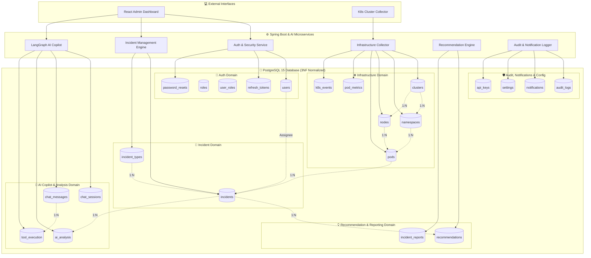
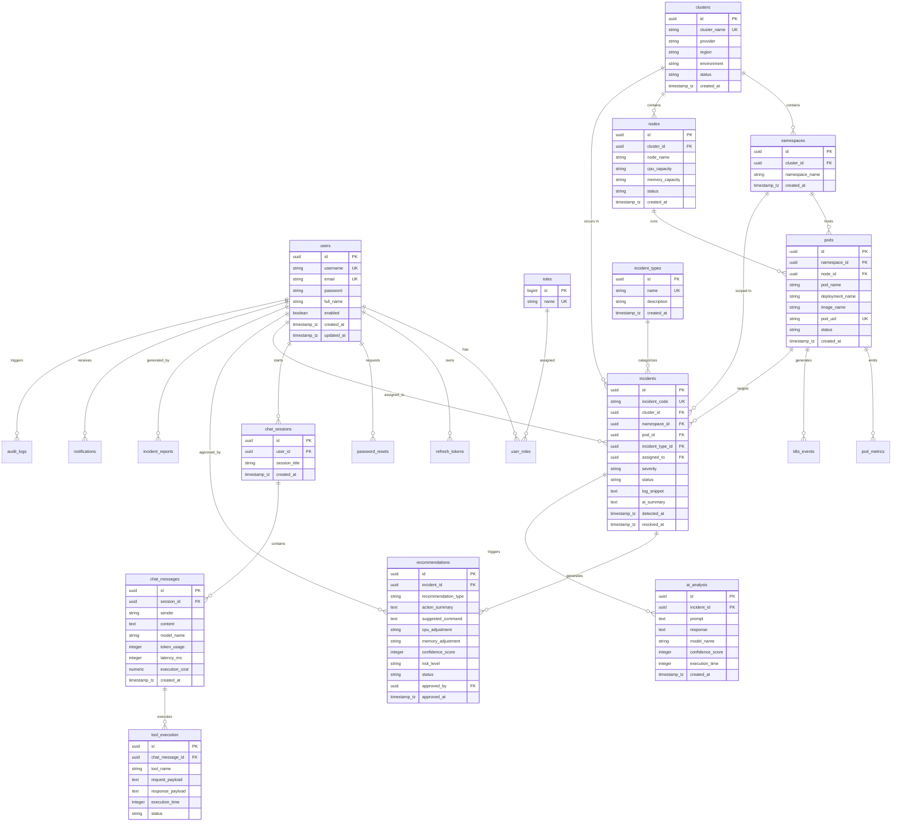
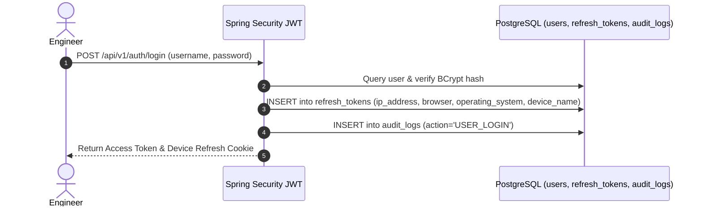
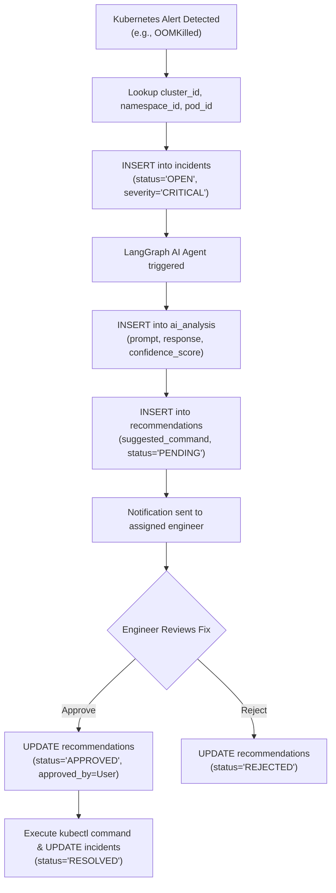

# KubeMind Production-Grade Database Schema Documentation (3NF)

This document provides a comprehensive, enterprise-grade PostgreSQL database architectural specification for **KubeMind**. The schema is normalized into 3rd Normal Form (3NF), eliminating data redundancy, enforcing strict referential integrity, and supporting high-performance querying for Kubernetes monitoring, AI incident root cause analysis, copilot tool execution, audit logging, and automated remediation.

---

## 📑 Table of Contents

1. [Mermaid Architecture & System Data Flow](#1-mermaid-architecture--system-data-flow)
2. [Complete PostgreSQL Entity-Relationship Diagram (ERD)](#2-complete-postgresql-entity-relationship-diagram-erd)
3. [Domain Workflows & Sequence Diagrams](#3-domain-workflows--sequence-diagrams)
4. [Data Dictionary & 3NF Schema Specification](#4-data-dictionary--3nf-schema-specification)
5. [PostgreSQL DDL Creation Scripts & Flyway Migrations](#5-postgresql-ddl-creation-scripts--flyway-migrations)
6. [Spring Boot JPA Entities & Repositories Guide](#6-spring-boot-jpa-entities--repositories-guide)
7. [Indexes & Performance Optimization Strategy](#7-indexes--performance-optimization-strategy)
8. [Database Constraints Reference](#8-database-constraints-reference)
9. [Sample Production Seed Data](#9-sample-production-seed-data)
10. [Dashboard SQL Queries & Analytics Operations](#10-dashboard-sql-queries--analytics-operations)

---

## 1. Mermaid Architecture & System Data Flow

The diagram below maps how the React Frontend, Spring Boot Backend Services, LangGraph AI Copilot, Kubernetes Monitoring, and MCP Tools interact with the normalized PostgreSQL Database domains.



---

## 2. Complete PostgreSQL Entity-Relationship Diagram (ERD)



---

## 3. Domain Workflows & Sequence Diagrams

### 3.1 Authentication & Device Audit Workflow


### 3.2 Automated Incident RCA & Recommendation Approval Lifecycle


---

## 4. Data Dictionary & 3NF Schema Specification

### 4.1 Authentication Domain Tables

#### `users`
| Column | Type | Constraints | Description |
|---|---|---|---|
| `id` | `UUID` | `PRIMARY KEY`, `DEFAULT gen_random_uuid()` | Unique user identifier |
| `username` | `VARCHAR(50)` | `NOT NULL`, `UNIQUE` | Unique login username |
| `email` | `VARCHAR(100)` | `NOT NULL`, `UNIQUE` | Email address |
| `full_name` | `VARCHAR(100)` | `NULLABLE` | Full display name |
| `password` | `VARCHAR(255)` | `NOT NULL` | BCrypt encrypted password hash |
| `enabled` | `BOOLEAN` | `DEFAULT TRUE` | Account status flag |
| `created_at` | `TIMESTAMPTZ` | `DEFAULT CURRENT_TIMESTAMP` | Account creation timestamp |
| `updated_at` | `TIMESTAMPTZ` | `DEFAULT CURRENT_TIMESTAMP` | Last update timestamp |

#### `refresh_tokens`
| Column | Type | Constraints | Description |
|---|---|---|---|
| `id` | `UUID` | `PRIMARY KEY`, `DEFAULT gen_random_uuid()` | Token record ID |
| `user_id` | `UUID` | `FK -> users(id) ON DELETE CASCADE` | Associated user ID |
| `token` | `VARCHAR(255)` | `NOT NULL`, `UNIQUE` | JWT refresh token |
| `expiry_date` | `TIMESTAMPTZ` | `NOT NULL` | Token expiry timestamp |
| `revoked` | `BOOLEAN` | `DEFAULT FALSE` | Revocation status |
| `ip_address` | `VARCHAR(45)` | `NULLABLE` | Client IPv4/IPv6 address |
| `browser` | `VARCHAR(100)` | `NULLABLE` | Client browser name/version |
| `operating_system`| `VARCHAR(100)`| `NULLABLE` | Client OS (Windows/Linux/macOS) |
| `device_name` | `VARCHAR(100)` | `NULLABLE` | Device model/name |
| `last_used_at` | `TIMESTAMPTZ` | `DEFAULT CURRENT_TIMESTAMP` | Last token usage timestamp |

---

### 4.2 Infrastructure Domain Tables

#### `clusters`
| Column | Type | Constraints | Description |
|---|---|---|---|
| `id` | `UUID` | `PRIMARY KEY`, `DEFAULT gen_random_uuid()` | Cluster UUID |
| `cluster_name` | `VARCHAR(100)` | `NOT NULL`, `UNIQUE` | Cluster name (e.g. `k8s-prod-us-east`) |
| `provider` | `VARCHAR(50)` | `NOT NULL` | Cloud provider (`AWS-EKS`, `Azure-AKS`, `Google-GKE`, `Minikube`) |
| `region` | `VARCHAR(50)` | `NULLABLE` | Provider region (e.g. `us-east-1`) |
| `environment` | `VARCHAR(50)` | `DEFAULT 'production'` | Deployment environment |
| `status` | `VARCHAR(50)` | `DEFAULT 'ACTIVE'` | Cluster health status |

#### `namespaces`
| Column | Type | Constraints | Description |
|---|---|---|---|
| `id` | `UUID` | `PRIMARY KEY`, `DEFAULT gen_random_uuid()` | Namespace UUID |
| `cluster_id` | `UUID` | `FK -> clusters(id) ON DELETE CASCADE` | Owning cluster |
| `namespace_name`| `VARCHAR(100)` | `NOT NULL` | K8s Namespace name |
| **UK Constraint**| `(cluster_id, namespace_name)` | `UNIQUE` | Unique namespace per cluster |

#### `nodes`
| Column | Type | Constraints | Description |
|---|---|---|---|
| `id` | `UUID` | `PRIMARY KEY`, `DEFAULT gen_random_uuid()` | Node UUID |
| `cluster_id` | `UUID` | `FK -> clusters(id) ON DELETE CASCADE` | Cluster hosting node |
| `node_name` | `VARCHAR(150)` | `NOT NULL` | K8s node hostname |
| `cpu_capacity` | `VARCHAR(50)` | `NOT NULL` | Allocatable CPU (e.g. `8 vCPU`) |
| `memory_capacity`| `VARCHAR(50)`| `NOT NULL` | Allocatable RAM (e.g. `32Gi`) |
| `status` | `VARCHAR(50)` | `DEFAULT 'READY'` | Node status (`READY`, `NOT_READY`) |

#### `pods`
| Column | Type | Constraints | Description |
|---|---|---|---|
| `id` | `UUID` | `PRIMARY KEY`, `DEFAULT gen_random_uuid()` | Pod UUID |
| `namespace_id` | `UUID` | `FK -> namespaces(id) ON DELETE CASCADE` | Owning namespace |
| `node_id` | `UUID` | `FK -> nodes(id) ON DELETE SET NULL` | Worker node running pod |
| `pod_name` | `VARCHAR(150)` | `NOT NULL` | K8s Pod name |
| `deployment_name`| `VARCHAR(150)`| `NULLABLE` | Parent deployment |
| `image_name` | `VARCHAR(255)` | `NOT NULL` | Container image repository/tag |
| `pod_uid` | `VARCHAR(100)` | `UNIQUE` | K8s system UID |
| `status` | `VARCHAR(50)` | `DEFAULT 'RUNNING'` | Pod status (`RUNNING`, `FAILED`, `PENDING`) |

---

### 4.3 Incident & Recommendation Domain Tables

#### `incident_types`
| Column | Type | Constraints | Description |
|---|---|---|---|
| `id` | `UUID` | `PRIMARY KEY`, `DEFAULT gen_random_uuid()` | Type ID |
| `name` | `VARCHAR(100)` | `NOT NULL`, `UNIQUE` | Anomaly name (`OOMKilled`, `CrashLoopBackOff`, etc.) |
| `description` | `TEXT` | `NULLABLE` | Technical description of anomaly |

#### `incidents`
| Column | Type | Constraints | Description |
|---|---|---|---|
| `id` | `UUID` | `PRIMARY KEY`, `DEFAULT gen_random_uuid()` | Incident ID |
| `incident_code` | `VARCHAR(50)` | `NOT NULL`, `UNIQUE` | Readable code (`INC-9042`) |
| `cluster_id` | `UUID` | `FK -> clusters(id) ON DELETE CASCADE` | Target cluster |
| `namespace_id` | `UUID` | `FK -> namespaces(id) ON DELETE CASCADE` | Target namespace |
| `pod_id` | `UUID` | `FK -> pods(id) ON DELETE CASCADE` | Target pod |
| `incident_type_id`| `UUID` | `FK -> incident_types(id) ON DELETE RESTRICT` | Anomaly classification |
| `assigned_to` | `UUID` | `FK -> users(id) ON DELETE SET NULL` | Engineer assigned |
| `severity` | `VARCHAR(20)` | `CHECK IN ('INFO', 'LOW', 'MEDIUM', 'HIGH', 'CRITICAL')` | Severity level |
| `status` | `VARCHAR(20)` | `CHECK IN ('OPEN', 'INVESTIGATING', 'IN_PROGRESS', 'RESOLVED', 'CLOSED')` | Resolution status |
| `log_snippet` | `TEXT` | `NULLABLE` | Crash log excerpt |
| `ai_summary` | `TEXT` | `NULLABLE` | AI Root Cause Summary |

#### `recommendations`
| Column | Type | Constraints | Description |
|---|---|---|---|
| `id` | `UUID` | `PRIMARY KEY`, `DEFAULT gen_random_uuid()` | Recommendation ID |
| `incident_id` | `UUID` | `FK -> incidents(id) ON DELETE CASCADE` | Target incident |
| `recommendation_type`| `VARCHAR(50)`| `NOT NULL` | Fix category (`RESOURCE_ADJUSTMENT`, `REPLICA_SCALING`) |
| `action_summary`| `TEXT` | `NOT NULL` | Executive summary of recommended fix |
| `suggested_command`| `TEXT` | `NULLABLE` | Ready-to-run `kubectl` command |
| `cpu_adjustment` | `VARCHAR(50)` | `NULLABLE` | CPU adjustment spec |
| `memory_adjustment`| `VARCHAR(50)`| `NULLABLE` | RAM adjustment spec |
| `risk_level` | `VARCHAR(20)` | `CHECK IN ('LOW', 'MEDIUM', 'HIGH')` | Risk rating |
| `status` | `VARCHAR(20)` | `CHECK IN ('PENDING', 'APPROVED', 'REJECTED', 'APPLIED')` | Workflow state |
| `approved_by` | `UUID` | `FK -> users(id) ON DELETE SET NULL` | Approving engineer |

---

### 4.4 AI Copilot & Analysis Domain Tables

#### `chat_messages`
| Column | Type | Constraints | Description |
|---|---|---|---|
| `id` | `UUID` | `PRIMARY KEY` | Message ID |
| `session_id` | `UUID` | `FK -> chat_sessions(id) ON DELETE CASCADE` | Parent session |
| `sender` | `VARCHAR(20)` | `NOT NULL` | Sender (`user`, `assistant`) |
| `content` | `TEXT` | `NOT NULL` | Content |
| `model_name` | `VARCHAR(100)`| `DEFAULT 'gemini-3.6-flash'` | LLM model invoked |
| `token_usage` | `INT` | `DEFAULT 0` | Prompt + Completion token count |
| `latency_ms` | `INT` | `DEFAULT 0` | Execution latency in milliseconds |
| `execution_cost`| `NUMERIC(10,6)`| `DEFAULT 0.000000` | Estimated API execution cost in USD |

#### `ai_analysis`
| Column | Type | Constraints | Description |
|---|---|---|---|
| `id` | `UUID` | `PRIMARY KEY` | Analysis record ID |
| `incident_id` | `UUID` | `FK -> incidents(id) ON DELETE CASCADE` | Associated incident |
| `prompt` | `TEXT` | `NOT NULL` | Prompt fed to LLM |
| `response` | `TEXT` | `NOT NULL` | Model response output |
| `model_name` | `VARCHAR(100)`| `NOT NULL` | AI model name |
| `confidence_score`| `INT` | `DEFAULT 95` | RCA confidence rating (0-100) |
| `execution_time` | `INT` | `DEFAULT 1200` | Inference time in ms |

#### `tool_execution`
| Column | Type | Constraints | Description |
|---|---|---|---|
| `id` | `UUID` | `PRIMARY KEY` | Execution record ID |
| `chat_message_id`| `UUID` | `FK -> chat_messages(id) ON DELETE CASCADE` | Triggering chat message |
| `tool_name` | `VARCHAR(100)`| `NOT NULL` | Executed MCP tool name (`getPods`, `getLogs`) |
| `request_payload`| `TEXT` | `NULLABLE` | Tool input parameters |
| `response_payload`| `TEXT` | `NULLABLE` | Tool output payload |
| `execution_time` | `INT` | `DEFAULT 0` | Tool response time in ms |
| `status` | `VARCHAR(50)` | `DEFAULT 'SUCCESS'` | Tool execution result |

---

### 4.5 Audit, Notification & Config Tables

#### `notifications`
| Column | Type | Constraints | Description |
|---|---|---|---|
| `id` | `UUID` | `PRIMARY KEY` | Notification ID |
| `user_id` | `UUID` | `FK -> users(id) ON DELETE CASCADE` | Target user |
| `title` | `VARCHAR(200)`| `NOT NULL` | Alert title |
| `message` | `TEXT` | `NOT NULL` | Body text |
| `type` | `VARCHAR(50)` | `DEFAULT 'INFO'` | Category (`INFO`, `CRITICAL`, `INCIDENT_ASSIGNED`) |
| `is_read` | `BOOLEAN` | `DEFAULT FALSE` | Unread status flag |

#### `audit_logs`
| Column | Type | Constraints | Description |
|---|---|---|---|
| `id` | `UUID` | `PRIMARY KEY` | Audit record ID |
| `user_id` | `UUID` | `FK -> users(id) ON DELETE SET NULL` | Performing user |
| `entity_name` | `VARCHAR(100)`| `NOT NULL` | Target entity (`Incident`, `Recommendation`) |
| `entity_id` | `VARCHAR(100)`| `NOT NULL` | Target entity primary key |
| `action` | `VARCHAR(50)` | `NOT NULL` | Action (`CREATE`, `UPDATE`, `APPROVE_RECOMMENDATION`) |
| `old_value` | `JSONB` | `NULLABLE` | Pre-change JSON snapshot |
| `new_value` | `JSONB` | `NULLABLE` | Post-change JSON snapshot |

---

## 5. PostgreSQL DDL Creation Scripts & Flyway Migrations

The complete Flyway migration scripts are maintained under `backend/src/main/resources/db/migration/`:

1. [`V1__init_schema.sql`](file:///d:/github/kubmind/backend/src/main/resources/db/migration/V1__init_schema.sql): Auth schema (`users`, `roles`, `user_roles`, `refresh_tokens`, `password_resets`).
2. [`V2__incidents_schema.sql`](file:///d:/github/kubmind/backend/src/main/resources/db/migration/V2__incidents_schema.sql): Baseline incidents table & initial seed data.
3. [`V3__chat_history_schema.sql`](file:///d:/github/kubmind/backend/src/main/resources/db/migration/V3__chat_history_schema.sql): Chat sessions & chat messages.
4. [`V4__recommendations_and_reports_schema.sql`](file:///d:/github/kubmind/backend/src/main/resources/db/migration/V4__recommendations_and_reports_schema.sql): Initial recommendations & telemetry reports.
5. [`V5__production_normalized_schema.sql`](file:///d:/github/kubmind/backend/src/main/resources/db/migration/V5__production_normalized_schema.sql): **Complete 3NF Normalization**:
   - Creates `clusters`, `namespaces`, `nodes`, `pods`, `pod_metrics`, `k8s_events`.
   - Creates `incident_types`, `ai_analysis`, `tool_execution`, `notifications`, `audit_logs`, `settings`, `api_keys`.
   - Refactors `incidents`, `recommendations`, `chat_sessions`, `chat_messages`, `incident_reports` with strict foreign keys & JSONB support.

---

## 6. Spring Boot JPA Entities & Repositories Guide

The 3NF database schema is mapped directly to Spring Data JPA entities in package `io.kubemind.backend.entity`:

| JPA Entity File | Database Table | Key Attributes & Associations |
|---|---|---|
| [`Cluster.java`](file:///d:/github/kubmind/backend/src/main/java/io/kubemind/backend/entity/Cluster.java) | `clusters` | `@Column(unique=true) clusterName` |
| [`Namespace.java`](file:///d:/github/kubmind/backend/src/main/java/io/kubemind/backend/entity/Namespace.java) | `namespaces` | `@ManyToOne Cluster cluster` |
| [`Node.java`](file:///d:/github/kubmind/backend/src/main/java/io/kubemind/backend/entity/Node.java) | `nodes` | `@ManyToOne Cluster cluster` |
| [`Pod.java`](file:///d:/github/kubmind/backend/src/main/java/io/kubemind/backend/entity/Pod.java) | `pods` | `@ManyToOne Namespace namespace`, `@ManyToOne Node node` |
| [`PodMetric.java`](file:///d:/github/kubmind/backend/src/main/java/io/kubemind/backend/entity/PodMetric.java) | `pod_metrics` | `@ManyToOne Pod pod`, `collectedAt` |
| [`K8sEvent.java`](file:///d:/github/kubmind/backend/src/main/java/io/kubemind/backend/entity/K8sEvent.java) | `k8s_events` | `@ManyToOne Pod pod`, `eventType`, `reason` |
| [`IncidentType.java`](file:///d:/github/kubmind/backend/src/main/java/io/kubemind/backend/entity/IncidentType.java) | `incident_types` | `@Column(unique=true) name` |
| [`Incident.java`](file:///d:/github/kubmind/backend/src/main/java/io/kubemind/backend/entity/Incident.java) | `incidents` | FKs to `Cluster`, `Namespace`, `Pod`, `IncidentType`, `User` |
| [`Recommendation.java`](file:///d:/github/kubmind/backend/src/main/java/io/kubemind/backend/entity/Recommendation.java) | `recommendations` | FKs to `Incident`, `User (approvedBy)` |
| [`AiAnalysis.java`](file:///d:/github/kubmind/backend/src/main/java/io/kubemind/backend/entity/AiAnalysis.java) | `ai_analysis` | FK to `Incident`, `confidenceScore` |
| [`ChatSession.java`](file:///d:/github/kubmind/backend/src/main/java/io/kubemind/backend/entity/ChatSession.java) | `chat_sessions` | FK to `User` |
| [`ChatMessage.java`](file:///d:/github/kubmind/backend/src/main/java/io/kubemind/backend/entity/ChatMessage.java) | `chat_messages` | FK to `ChatSession`, `tokenUsage`, `latencyMs` |
| [`ToolExecution.java`](file:///d:/github/kubmind/backend/src/main/java/io/kubemind/backend/entity/ToolExecution.java) | `tool_execution` | FK to `ChatMessage`, `toolName`, `executionTime` |
| [`Notification.java`](file:///d:/github/kubmind/backend/src/main/java/io/kubemind/backend/entity/Notification.java) | `notifications` | FK to `User`, `isRead` |
| [`AuditLog.java`](file:///d:/github/kubmind/backend/src/main/java/io/kubemind/backend/entity/AuditLog.java) | `audit_logs` | FK to `User`, `oldValue`, `newValue` |
| [`Setting.java`](file:///d:/github/kubmind/backend/src/main/java/io/kubemind/backend/entity/Setting.java) | `settings` | `@Id key` |
| [`ApiKey.java`](file:///d:/github/kubmind/backend/src/main/java/io/kubemind/backend/entity/ApiKey.java) | `api_keys` | `provider`, `encryptedKey` |

Corresponding Spring Data Repositories reside in `io.kubemind.backend.repository` (e.g. `IncidentRepository.java`, `PodRepository.java`, `RecommendationRepository.java`).

---

## 7. Indexes & Performance Optimization Strategy

To guarantee sub-10ms query execution across millions of telemetry records, performance indexes are configured:

| Target Table | Index Name | Indexed Column(s) | Optimization Target |
|---|---|---|---|
| `users` | `idx_users_username` | `username` | Instant login verification |
| `users` | `idx_users_email` | `email` | Unique account validation |
| `incidents` | `idx_incidents_status` | `status` | Filter active incidents |
| `incidents` | `idx_incidents_severity` | `severity` | Critical incident sorting |
| `incidents` | `idx_incidents_detected_at` | `detected_at DESC` | Timeline chronological sorting |
| `incidents` | `idx_incidents_cluster_id` | `cluster_id` | Multi-tenant cluster isolation |
| `incidents` | `idx_incidents_assigned_to` | `assigned_to` | Engineer workspace view |
| **Composite** | `idx_incidents_status_severity` | `(status, severity)` | High-priority dashboard widgets |
| **Composite** | `idx_incidents_cluster_status` | `(cluster_id, status)` | Per-cluster open alert count |
| `pod_metrics` | `idx_pod_metrics_pod_time` | `(pod_id, collected_at DESC)`| Time-series pod metrics graphing |
| `chat_messages` | `idx_chat_messages_session` | `session_id` | Chat thread rendering |
| `chat_messages` | `idx_chat_messages_created_at` | `created_at DESC` | Recent conversation lookup |
| `notifications` | `idx_notifications_user_id` | `(user_id, is_read)` | Unread alert badge counts |
| `audit_logs` | `idx_audit_logs_user_id` | `user_id` | Compliance user activity search |

---

## 8. Database Constraints Reference

- **Foreign Key Constraints (`ON DELETE CASCADE` / `SET NULL`)**:
  - `namespaces` $\rightarrow$ `clusters` (`CASCADE`)
  - `pods` $\rightarrow$ `namespaces` (`CASCADE`), `nodes` (`SET NULL`)
  - `incidents` $\rightarrow$ `clusters` (`CASCADE`), `namespaces` (`CASCADE`), `pods` (`CASCADE`), `incident_types` (`RESTRICT`), `users` (`SET NULL`)
  - `recommendations` $\rightarrow$ `incidents` (`CASCADE`), `users` (`SET NULL`)
  - `chat_messages` $\rightarrow$ `chat_sessions` (`CASCADE`)
  - `tool_execution` $\rightarrow$ `chat_messages` (`CASCADE`)
  - `notifications` $\rightarrow$ `users` (`CASCADE`)
- **Check Constraints**:
  - `incidents.severity`: `CHECK (severity IN ('INFO', 'LOW', 'MEDIUM', 'HIGH', 'CRITICAL'))`
  - `incidents.status`: `CHECK (status IN ('OPEN', 'INVESTIGATING', 'IN_PROGRESS', 'RESOLVED', 'CLOSED'))`
  - `recommendations.risk_level`: `CHECK (risk_level IN ('LOW', 'MEDIUM', 'HIGH'))`
  - `recommendations.status`: `CHECK (status IN ('PENDING', 'APPROVED', 'REJECTED', 'APPLIED'))`
- **Unique Constraints**:
  - `namespaces(cluster_id, namespace_name)`
  - `nodes(cluster_id, node_name)`
  - `pods(namespace_id, pod_name)`

---

## 9. Sample Production Seed Data

Migration `V5` seeds initial infrastructure and test records:
- **Default Operator**: Username `operator` (`a0eebc99-9c0b-4ef8-bb6d-6bb9bd380a11`), assigned `ROLE_ADMIN` & `ROLE_DEVELOPER`.
- **Incident Types**: `OOMKilled`, `CrashLoopBackOff`, `ImagePullBackOff`, `FailedScheduling`, `NodeNotReady`, `NetworkError`, `DiskPressure`.
- **Clusters**: `k8s-prod-us-east` (AWS-EKS), `k8s-stage-us-west` (Google-GKE).
- **Namespaces**: `payment-service`, `authentication`, `telemetry`, `ingress-nginx`.
- **Pods**: `payment-processor-78d9b-x92q`, `auth-gateway-55c4d-m41k`, `ingress-nginx-controller-88c9-k1z0`, `prometheus-worker-0`.
- **Active Incidents**: `INC-9042` (Critical OOMKilled), `INC-9041` (Critical CrashLoopBackOff), `INC-9039` (Warning FailedScheduling).

---

## 10. Dashboard SQL Queries & Analytics Operations

### Query 1: Open Critical & High Incidents by Cluster (Dashboard Overview)
```sql
SELECT 
    c.cluster_name,
    n.namespace_name,
    p.pod_name,
    it.name AS incident_type,
    i.incident_code,
    i.severity,
    i.status,
    u.full_name AS assigned_engineer,
    i.detected_at
FROM incidents i
JOIN clusters c ON i.cluster_id = c.id
JOIN namespaces n ON i.namespace_id = n.id
JOIN pods p ON i.pod_id = p.id
JOIN incident_types it ON i.incident_type_id = it.id
LEFT JOIN users u ON i.assigned_to = u.id
WHERE i.status IN ('OPEN', 'INVESTIGATING', 'IN_PROGRESS')
  AND i.severity IN ('HIGH', 'CRITICAL')
ORDER BY i.detected_at DESC;
```

### Query 2: Mean Time to Resolution (MTTR) by Incident Type
```sql
SELECT 
    it.name AS incident_type,
    COUNT(i.id) AS total_resolved,
    AVG(EXTRACT(EPOCH FROM (i.resolved_at - i.detected_at)) / 60)::NUMERIC(10,2) AS avg_mttr_minutes
FROM incidents i
JOIN incident_types it ON i.incident_type_id = it.id
WHERE i.status = 'RESOLVED'
  AND i.resolved_at IS NOT NULL
GROUP BY it.name
ORDER BY avg_mttr_minutes DESC;
```

### Query 3: Pending AI Recommendations Awaiting Approval
```sql
SELECT 
    r.id AS recommendation_id,
    i.incident_code,
    c.cluster_name,
    n.namespace_name,
    r.recommendation_type,
    r.action_summary,
    r.suggested_command,
    r.risk_level,
    r.confidence_score,
    r.created_at
FROM recommendations r
JOIN incidents i ON r.incident_id = i.id
JOIN clusters c ON i.cluster_id = c.id
JOIN namespaces n ON i.namespace_id = n.id
WHERE r.status = 'PENDING'
ORDER BY r.confidence_score DESC;
```

### Query 4: Unread Notifications for Logged-In User
```sql
SELECT 
    id,
    title,
    message,
    type,
    created_at
FROM notifications
WHERE user_id = 'a0eebc99-9c0b-4ef8-bb6d-6bb9bd380a11'
  AND is_read = FALSE
ORDER BY created_at DESC;
```

### Query 5: System Audit Trail for Resource Modifications
```sql
SELECT 
    al.id,
    u.username,
    al.entity_name,
    al.entity_id,
    al.action,
    al.old_value,
    al.new_value,
    al.created_at
FROM audit_logs al
LEFT JOIN users u ON al.user_id = u.id
ORDER BY al.created_at DESC
LIMIT 50;
```
